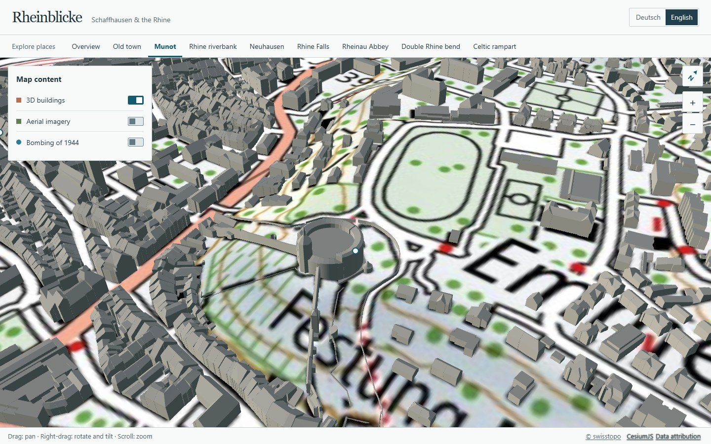
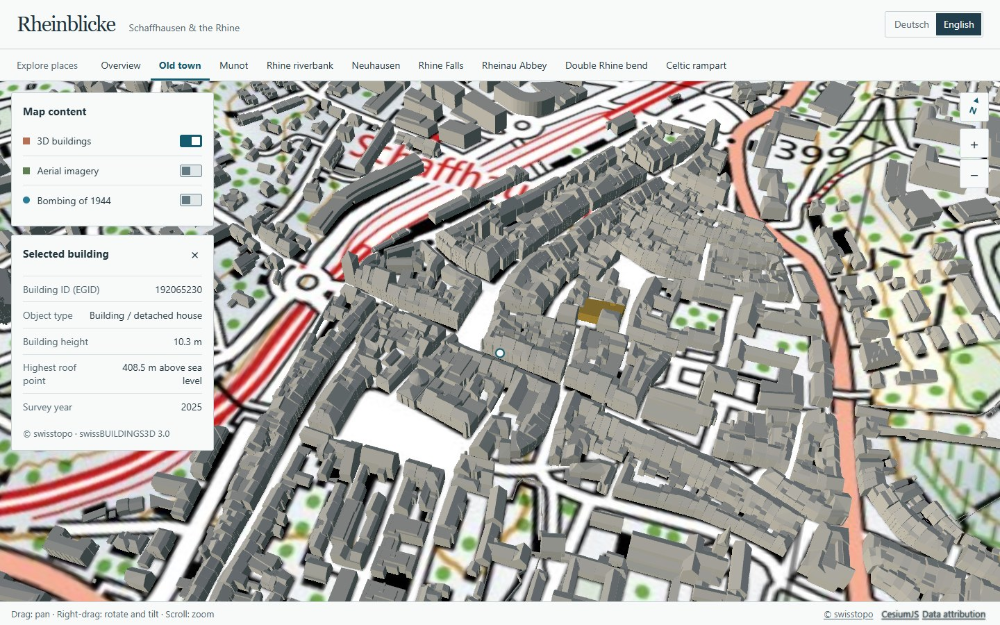
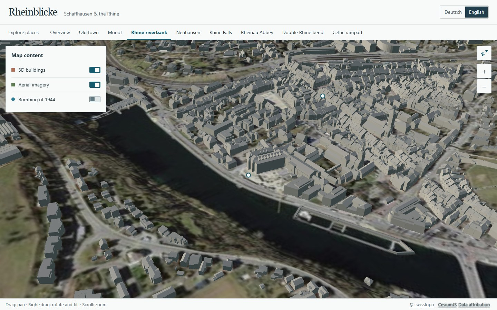
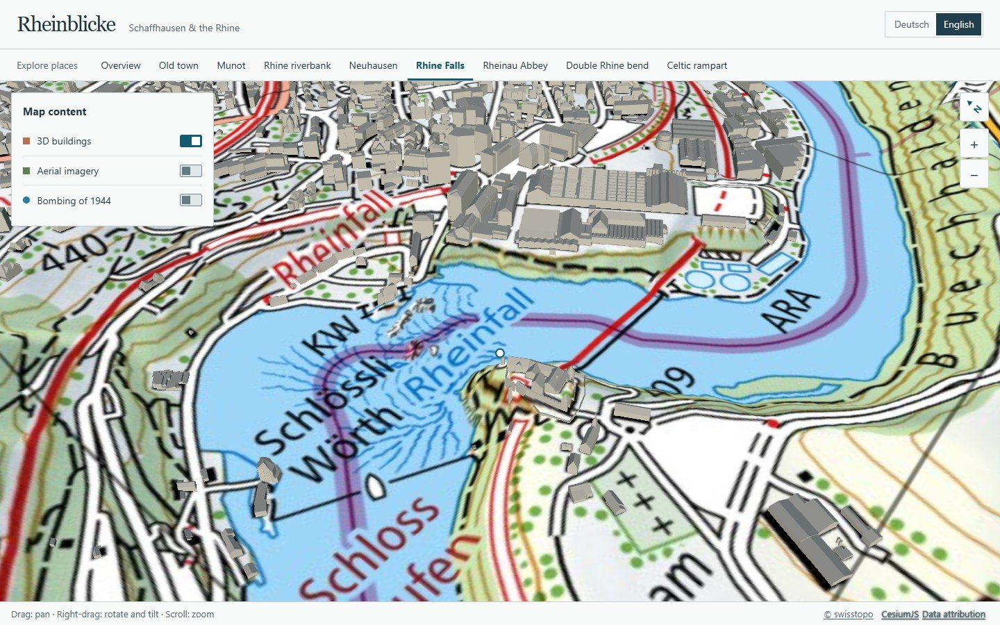
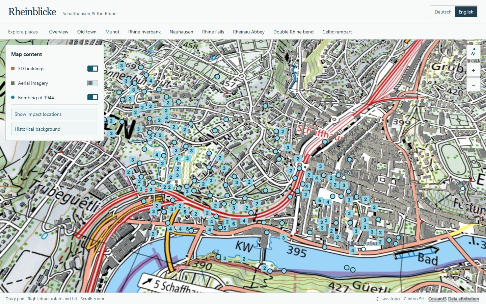
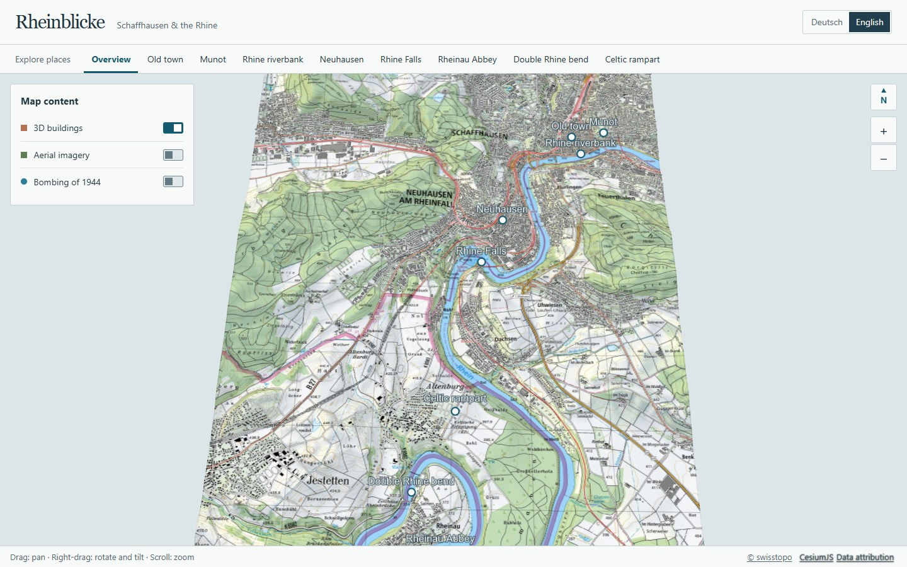
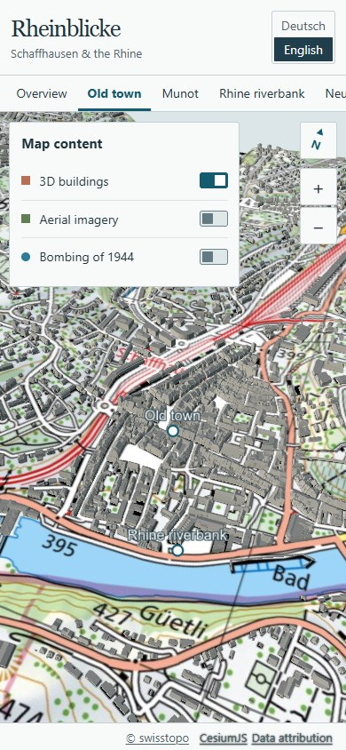

# Rheinblicke

[Deutsch](README.md) · [English](README.en.md)

Look across Schaffhausen from the Munot, follow the Rhine to Rheinau or click an individual building: Rheinblicke lets you explore the town and its surroundings in a browser-based 3D map. You can also switch on aerial imagery and the documented impact locations from the bombing of 1944.



## Run locally

You need **Node.js 22.12 or later**. From the project directory:

```sh
npm ci
npm run dev
```

Open the address Vite prints in the terminal, usually `http://localhost:5173`. The map data is already included in the repository, so no API key is needed. Your browser must support WebGL. In Windows PowerShell, use `npm.cmd` if the script execution policy blocks `npm`.

## Explore the map

Choose a place in the top bar, such as **Old town**, **Munot** or **Rhine Falls**. You can also click the place markers on the map. On a phone, scroll the place bar sideways to see the other destinations.

| Input | Movement |
| --- | --- |
| Drag with the mouse | Pan |
| Hold the right mouse button and drag | Rotate and tilt |
| Mouse wheel | Zoom |
| Touch | One finger pans; two fingers zoom, rotate and tilt |
| Keyboard, with the map focused | Arrows pan, `+` / `−` zoom, `N` orients north |

**Deutsch / English** switches the language and remembers your choice. Your current view stays in place.

### Inspect a building

Click a building to highlight it in yellow and open the available information, such as its height, survey year and Swiss building ID (EGID). Some objects have missing attributes.



### Switch between the map and aerial imagery

Under **Map content**, turn on **Aerial imagery** or show and hide the **3D buildings**. The left image shows the Rhine riverbank with aerial imagery; the right shows the viewpoint at the Rhine Falls.

 

### Show the impact locations from 1944

**Bombing of 1944** displays 354 documented impact locations. Click a point to see its details, or a number to open the list of grouped locations. **Historical background** provides a short account and the sources.



The dataset records a subset of the impacts. [Dataset and terms of use](https://data.europa.eu/data/datasets/868d4efd-0f2e-46ab-adfb-ffc1056861d9-amt-geoinformation-kanton-schaffhausen?locale=en).

### From Schaffhausen to Rheinau

The map extends through Neuhausen and the Rhine Falls to Rheinau Abbey and the Celtic rampart in Altenburg. **Overview** shows the whole area. The same tools are available on narrow screens.

 

## Data and development

Buildings, terrain, the national map and aerial imagery come from **swisstopo**; the historical impact locations come from the **Canton of Schaffhausen**. The map contains 12,203 buildings across a 6 × 9 kilometre area. Terrain in Germany is coarser, and no additional German 3D buildings are included. The Celtic rampart has a place marker, but no separate detailed model of the rampart.

To build the app and preview the result locally:

```sh
npm run build
npm run preview
```

You can serve `dist/` from a static web server. `npm test` checks the map and language features, while `npm run check:links -- --external` checks file references and source links. See the [development guide](doc/development.en.md) for dataset details, regeneration steps and further checks.
