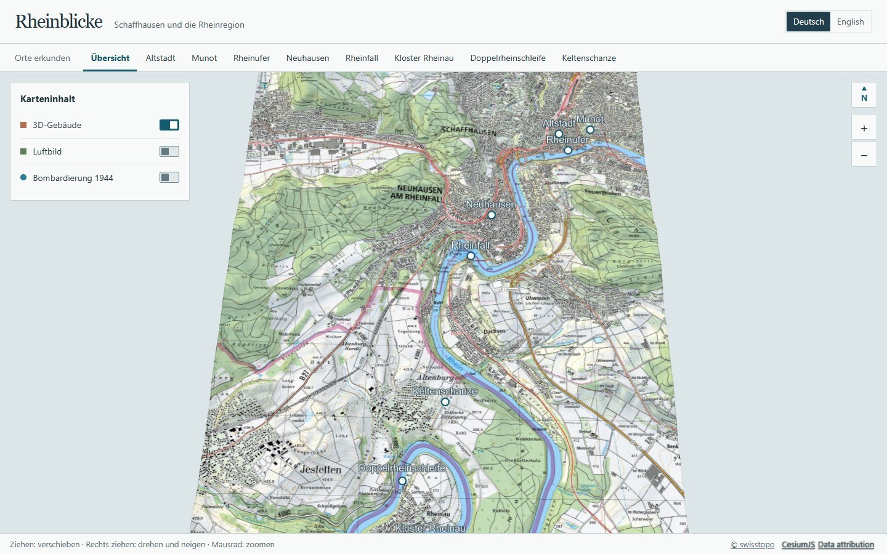
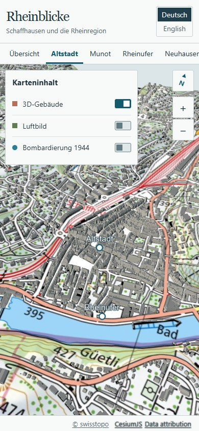

# Schaffhausen 3D

Interaktiver 3D-Zwilling von Schaffhausen und der Rheinregion bis Rheinau und Altenburg. Der Prototyp zeigt amtliche Gebäudegeometrien mit modellierten Dächern und Wänden auf dem tatsächlichen Gelände. Die Gebäudedaten umfassen je nach Objekt unter anderem Gebäudehöhe, Erfassungsjahr und eidgenössischen Gebäudeidentifikator (EGID).

## Starten

Voraussetzung ist Node.js 22.12 oder neuer.

```sh
npm ci
npm run dev
```

Öffne die im Terminal angezeigte Adresse. **Übersicht** zeigt das gesamte Gebiet. Die Schaltflächen **Altstadt**, **Munot**, **Rheinufer**, **Neuhausen**, **Rheinfall**, **Kloster Rheinau**, **Doppelrheinschleife** und **Keltenschanze** führen zu den jeweiligen Aussichtspunkten. Die Orte lassen sich auch über ihre hellgrünen Markierungen auf der Karte anfliegen. Mit Keltenschanze ist der [Keltenwall «Schanz» in Altenburg](https://www.outdooractive.com/de/poi/schwarzwald/keltenwall-altenburg/53673782/) gemeint; seine Zielkoordinaten stammen vom Regionalen Naturpark Schaffhausen. Auf schmalen Bildschirmen ist die Ortsnavigation horizontal scrollbar.

Ziehen verschiebt die Ansicht, Ziehen mit der rechten Maustaste neigt und dreht sie, und das Mausrad zoomt. Ein Klick auf ein Gebäude öffnet seine Angaben. Unter **Kartenlayer** lassen sich die Gebäude ausblenden und das Luftbild einblenden.

```sh
npm run build
npm run preview
```

`npm test` prüft die 354 historischen Marker, die Zuordnung der Quellinformationen, die Aktualisierung der Gruppenanzeige und die anklickbaren Aussichtspunkte.

Der Produktionsbuild liegt in `dist/` und lässt sich auf einem statischen Webserver bereitstellen. Der Viewer lädt alle Daten und CesiumJS-Ressourcen vom eigenen Server. Für den Betrieb sind kein Backend, kein API-Schlüssel und kein Cesium-ion-Konto erforderlich.

## Historischer Layer

Unter **Kartenlayer** blendet **Bombardierung 1944** die 354 dokumentierten Einschlagorte ein und fliegt das historische Gebiet an. Die hellblauen Punkte werden auch über Gebäuden angezeigt. **Einschlagorte zeigen** kehrt jederzeit zu dieser Ansicht zurück. Ein Klick auf einen Punkt zeigt Typ, Datum, WGS-84-Koordinaten und die Kennung aus der Quelle. Nahe beieinanderliegende Punkte werden mit ihrer Anzahl gruppiert. Ein Klick auf die Gruppe öffnet die Liste ihrer Orte. **Historische Einordnung** öffnet den Kurztext mit Quellen des Bundes, des Museums zu Allerheiligen und des Stadtarchivs.

Die Einschlagdaten beruhen auf historischen Unterlagen und erfassen einen Teil aller Einschläge. [Kantonaler Datensatz und Nutzungsbedingungen](https://opendata.swiss/de/dataset/bombardierung-schaffhausen-kanton-schaffhausen)

## Screenshots

### Übersicht



### Altstadt und Gebäudeinformationen


### Festung Munot


### Rheinufer mit Luftbild


### Mobile Ansicht



## Geodaten

Das Gebiet misst 6’000 × 9’000 Meter (LV95: 2’685’000 / 1’276’000 bis 2’691’000 / 1’285’000) und umfasst 12’203 Gebäude aus der Schweizer Datenabdeckung. Es werden folgende Datensätze verwendet (© swisstopo):

| Datensatz | Verwendung |
| --- | --- |
| [swissBUILDINGS3D 3.0](https://www.swisstopo.admin.ch/de/landschaftsmodell-swissbuildings3d-3-0) (Ausgabe 2025) | Originale Dreiecksflächen und verfügbare Gebäudeattribute als 3D Tiles |
| [swissALTI3D](https://www.swisstopo.admin.ch/de/hoehenmodell-swissalti3d) (Ausgabe 2026) | Gelände aus dem 2-Meter-Höhenmodell, für den Viewer auf einem 10-Meter-Raster abgetastet |
| [swissALTIRegio](https://www.swisstopo.admin.ch/de/hoehenmodell-swissaltiregio) | Ergänzung fehlender Geländehöhen auf deutschem Gebiet |
| [Landeskarte](https://map.geo.admin.ch/#/map?lang=de&bgLayer=ch.swisstopo.pixelkarte-farbe) | Basiskarte mit Beschriftungen und grenzüberschreitender Abdeckung |
| [Bombardierung Schaffhausen, Kanton Schaffhausen](https://opendata.swiss/de/dataset/bombardierung-schaffhausen-kanton-schaffhausen) | Dokumentierte Einschlagpunkte vom 1. April 1944 |
| [SWISSIMAGE](https://www.swisstopo.admin.ch/de/orthofotomosaik-swissimage-10-cm) (Ausgabe 2025) | Umschaltbares Orthofoto mit 2 Metern Bodenauflösung; fehlende Bildbereiche bleiben als Basiskarte sichtbar |

Die Gebäude und das Gelände werden gemeinsam von LV95/LN02 in WGS 84 mit ellipsoidischen Höhen transformiert. Die Gebäudeansicht zeigt die publizierten Höhen weiterhin in Metern über Meer. Strassen, Plätze, Grünflächen und Gewässer sind in dieser Version auf das Gelände projiziert. Gebäudedaten können leere Attribute enthalten.

Auf deutschem Gebiet ist die Geländegrundlage gröber; dort werden keine zusätzlichen 3D-Gebäude aus einer deutschen Quelle eingebunden. Die Keltenschanze ist als Ort markiert und über das Gelände und die Basiskarte erkundbar; ein separates Detailmodell des Walls ist nicht enthalten. Die bisherigen Screenshots zeigen das ursprüngliche Altstadtgebiet.

## Geodaten neu erzeugen

Die für den Start benötigten Daten liegen bereits in `public/geodata/`. Für die Neuaufbereitung benötigt Python die Pakete GDAL mit OpenFileGDB-Unterstützung, NumPy und pyproj mit PROJ 9.2 oder neuer. Unter Debian 13 stehen sie als `python3-gdal`, `python3-numpy` und `python3-pyproj` zur Verfügung.

```sh
python3 scripts/prepare_geodata.py
```

Das Skript ermittelt die publizierten Gelände-, Bild- und Gebäudekacheln über den amtlichen STAC-Katalog für das konfigurierte Gebiet und die festgelegten Ausgaben. Es lädt die Quellen und das swisstopo-Höhentransformationsgitter nach `.cache/`. Die Basiskarte wird beim ersten Aufruf vom Bundes-WMS abgerufen. Fehlende swissALTI3D-Höhen werden mit der swissALTIRegio-Kachel `2685-1274` ergänzt. Die über `--output` konfigurierbare Ausgabe enthält das Gebiet, die 3D Tiles mit Gebäudeattributen und die beiden Geländemodelle mit eingebetteten Texturen.

Für den historischen Layer lädt das Skript das [kantonale Originalarchiv](https://data.geo.sh.ch/ogd/bombardierung_schaffhausen.zip), liest die 354 Einschlagpunkte aus dem GeoPackage in LV95 und transformiert sie nach WGS 84. Das GeoJSON bewahrt die Original-ID, UUID und Typangabe. Die Anzeigehöhe wird aus dem heutigen Geländemodell abgeleitet. Im GeoJSON sind Downloadadresse, SHA-256 des Originalarchivs, GeoPackage-Pfad und Layername hinterlegt.

[Projektvision](Vision.md)
