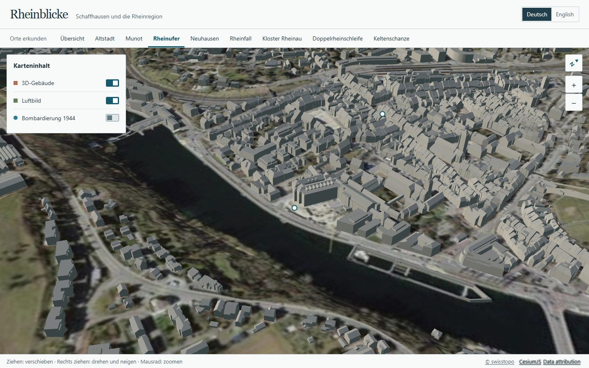
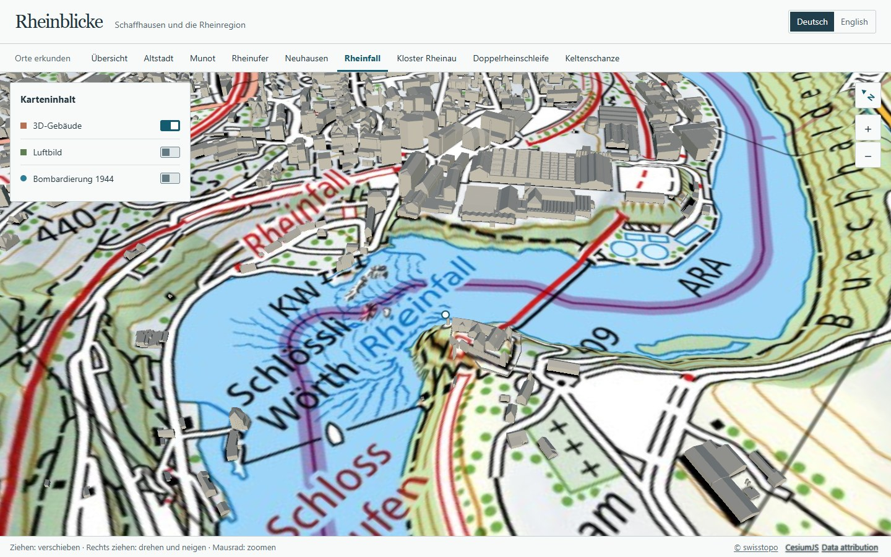
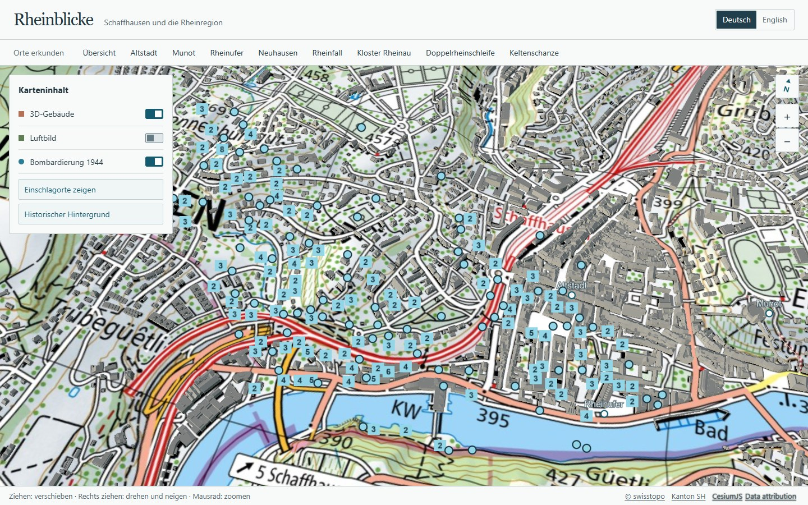

# Rheinblicke

[Deutsch](README.md) · [English](README.en.md)

Schaffhausen vom Munot aus ansehen, dem Rhein bis Rheinau folgen oder ein einzelnes Gebäude anklicken: Rheinblicke bringt die Stadt und ihre Umgebung als 3D-Karte in den Browser. Dazu gibt es Luftbilder und die dokumentierten Einschlagorte der Bombardierung von 1944.


## Lokal starten

Du brauchst **Node.js ab Version 22.12**. Im Projektordner:

```sh
npm ci
npm run dev
```

Öffne die Adresse, die Vite im Terminal anzeigt, normalerweise `http://localhost:5173`. Die Kartendaten liegen bereits im Repository; ein API-Schlüssel ist nicht nötig. Der Browser muss WebGL unterstützen. Unter Windows PowerShell kannst du `npm.cmd` verwenden, falls `npm` wegen der Skriptausführungsrichtlinie blockiert wird.

## Die Karte erkunden

Wähle oben einen Ort, zum Beispiel **Altstadt**, **Munot** oder **Rheinfall**. Du kannst auch die Ortsmarkierungen auf der Karte anklicken. Auf dem Handy lässt sich die Ortsleiste seitlich verschieben.

| Eingabe | Bewegung |
| --- | --- |
| Maus ziehen | Ansicht verschieben |
| Rechte Maustaste halten und ziehen | Drehen und neigen |
| Mausrad | Zoomen |
| Touch | Ein Finger verschiebt; zwei Finger zoomen, drehen und neigen |
| Tastatur, wenn die Karte fokussiert ist | Pfeile verschieben, `+` / `−` zoomen, `N` richtet nach Norden aus |

**Deutsch / English** schaltet die Sprache um und merkt sich deine Wahl. Die aktuelle Ansicht bleibt dabei erhalten.

### Ein Gebäude genauer ansehen

Ein Klick auf ein Gebäude markiert es gelb und öffnet die verfügbaren Angaben, etwa Höhe, Erfassungsjahr und Gebäude-ID (EGID). Nicht jedes Objekt hat alle Attribute.


### Zwischen Karte und Luftbild wechseln

Unter **Karteninhalt** kannst du das **Luftbild** einschalten und die **3D-Gebäude** ein- oder ausblenden. Links siehst du das Rheinufer mit Luftbild, rechts den Aussichtspunkt am Rheinfall.

 

### Die Einschlagorte von 1944 einblenden

**Bombardierung 1944** zeigt 354 dokumentierte Einschlagorte. Ein Klick auf einen Punkt öffnet seine Angaben; bei einer Zahl öffnet sich eine Liste der zusammengefassten Orte. **Historischer Hintergrund** enthält eine kurze Einordnung und die Quellen.



Die Daten erfassen einen Teil der damaligen Einschläge. [Datensatz und Nutzungsbedingungen](https://data.europa.eu/data/datasets/868d4efd-0f2e-46ab-adfb-ffc1056861d9-amt-geoinformation-kanton-schaffhausen?locale=de).

### Von Schaffhausen bis Rheinau

Die Karte reicht über Neuhausen und den Rheinfall bis zum Kloster Rheinau und zur Keltenschanze in Altenburg. **Übersicht** zeigt das ganze Gebiet. Dieselben Werkzeuge stehen auch auf schmalen Bildschirmen zur Verfügung.

 

## Daten und Entwicklung

Gebäude, Gelände, Landeskarte und Luftbild stammen von **swisstopo**, die historischen Einschlagorte vom **Kanton Schaffhausen**. Enthalten sind 12’203 Gebäude auf einem Gebiet von 6 × 9 Kilometern. Auf deutschem Gebiet ist das Gelände gröber und es gibt keine zusätzlichen deutschen 3D-Gebäude. Die Keltenschanze ist als Ort markiert; ein eigenes Detailmodell des Walls ist nicht enthalten.

Für einen Produktionsbuild und die lokale Vorschau:

```sh
npm run build
npm run preview
```

`dist/` lässt sich auf einem statischen Webserver bereitstellen. `npm test` prüft die Karten- und Sprachfunktionen, `npm run check:links -- --external` die Datei- und Quellenverweise. Details zu den Datensätzen, ihrer Neuaufbereitung und weiteren Prüfungen stehen in der [Entwicklungsanleitung](doc/development.md).
