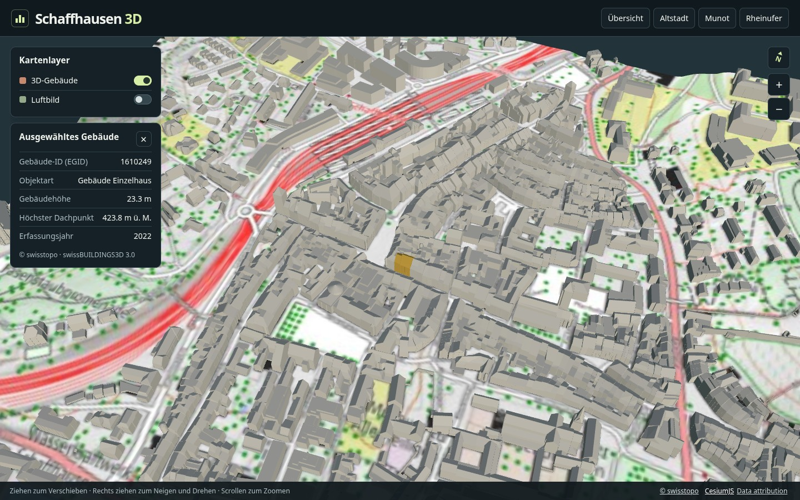
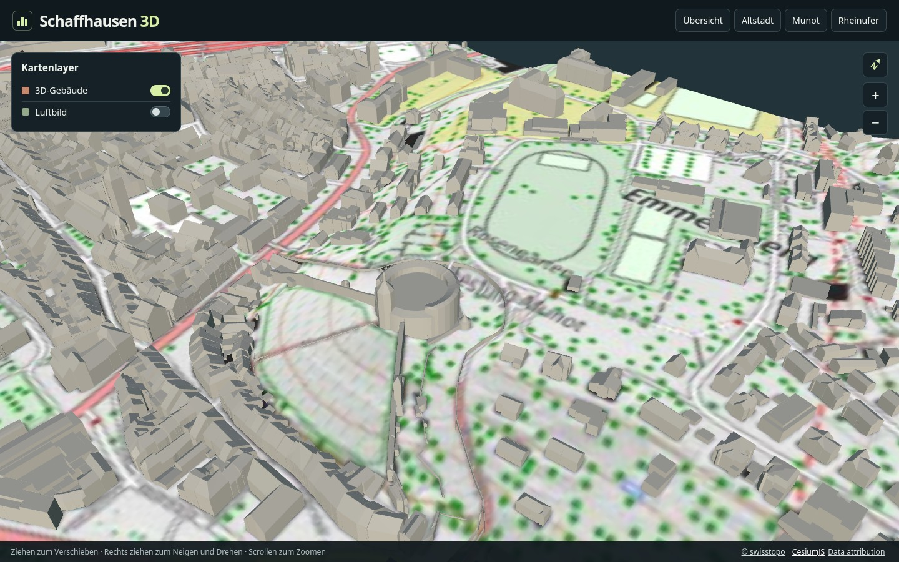

# Schaffhausen 3D

Interaktiver 3D-Zwilling der Schaffhauser Altstadt mit Munot und Rheinufer. Der Prototyp zeigt amtliche Gebäudegeometrien mit modellierten Dächern und Wänden auf dem tatsächlichen Gelände. Die Gebäudedaten umfassen je nach Objekt unter anderem Gebäudehöhe, Erfassungsjahr und eidgenössischen Gebäudeidentifikator (EGID).

## Starten

Voraussetzung ist Node.js 22.12 oder neuer.

```sh
npm ci
npm run dev
```

Öffne die im Terminal angezeigte Adresse. Im Viewer führen **Altstadt**, **Munot** und **Rheinufer** zu den jeweiligen Aussichtspunkten. Ziehen verschiebt die Ansicht, Ziehen mit der rechten Maustaste neigt und dreht sie, und das Mausrad zoomt. Ein Klick auf ein Gebäude öffnet seine Angaben. Unter **Kartenlayer** lassen sich die Gebäude ausblenden und das Luftbild einblenden.

```sh
npm run build
npm run preview
```

Der Produktionsbuild liegt in `dist/` und lässt sich auf einem statischen Webserver bereitstellen. Der Viewer lädt alle Daten und CesiumJS-Ressourcen vom eigenen Server. Für den Betrieb sind kein Backend, kein API-Schlüssel und kein Cesium-ion-Konto erforderlich.

## Screenshots

### Übersicht


### Altstadt und Gebäudeinformationen



### Festung Munot



### Rheinufer mit Luftbild


### Mobile Ansicht


## Geodaten

Das Testgebiet misst 1’540 × 1’190 Meter und umfasst 1’923 Gebäude. Es werden folgende Datensätze verwendet (© swisstopo):

| Datensatz | Verwendung |
| --- | --- |
| [swissBUILDINGS3D 3.0](https://www.swisstopo.admin.ch/de/landschaftsmodell-swissbuildings3d-3-0) (Ausgabe 2025) | Originale Dreiecksflächen und verfügbare Gebäudeattribute als 3D Tiles |
| [swissALTI3D](https://www.swisstopo.admin.ch/de/hoehenmodell-swissalti3d) (Ausgabe 2026) | Gelände aus dem 2-Meter-Höhenmodell, für den Viewer auf einem 7-Meter-Raster abgetastet |
| [swissTLM3D-Karte](https://map.geo.admin.ch/#/map?lang=de&bgLayer=ch.swisstopo.swisstlm3d-karte-farbe) | Basiskarte mit Strassen, Plätzen, Grünflächen und Gewässern |
| [SWISSIMAGE](https://www.swisstopo.admin.ch/de/orthofotomosaik-swissimage-10-cm) (Ausgabe 2025) | Umschaltbares Orthofoto mit 2 Metern Bodenauflösung |

Die Gebäude und das Gelände werden gemeinsam von LV95/LN02 in WGS 84 mit ellipsoidischen Höhen transformiert. Die Gebäudeansicht zeigt die publizierten Höhen weiterhin in Metern über Meer. Strassen, Plätze, Grünflächen und Gewässer sind in dieser Version auf das Gelände projiziert. Gebäudedaten können leere Attribute enthalten.

## Geodaten neu erzeugen

Die für den Start benötigten Daten liegen bereits in `public/geodata/`. Für die Neuaufbereitung benötigt Python die Pakete GDAL mit OpenFileGDB-Unterstützung, NumPy und pyproj mit PROJ 9.2 oder neuer. Unter Debian 13 stehen sie als `python3-gdal`, `python3-numpy` und `python3-pyproj` zur Verfügung.

```sh
python3 scripts/prepare_geodata.py
```

Das Skript lädt die Quellen und das swisstopo-Höhentransformationsgitter nach `.cache/`. Die Basiskarte wird beim ersten Aufruf vom Bundes-WMS abgerufen. Die über `--output` konfigurierbare Ausgabe enthält das Gebiet, die 3D Tiles mit Gebäudeattributen und die beiden Geländemodelle mit eingebetteten Texturen.

[Projektvision](Vision.md)
